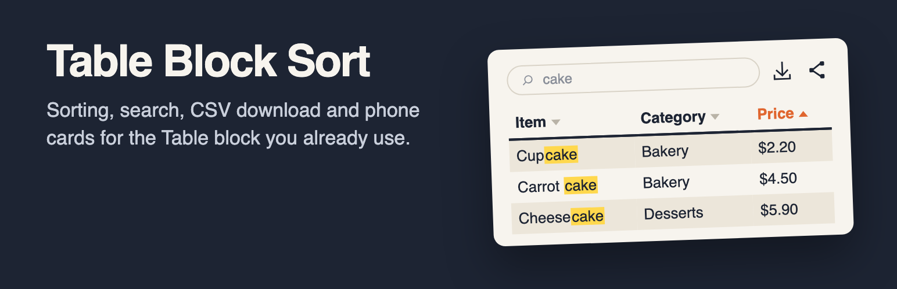
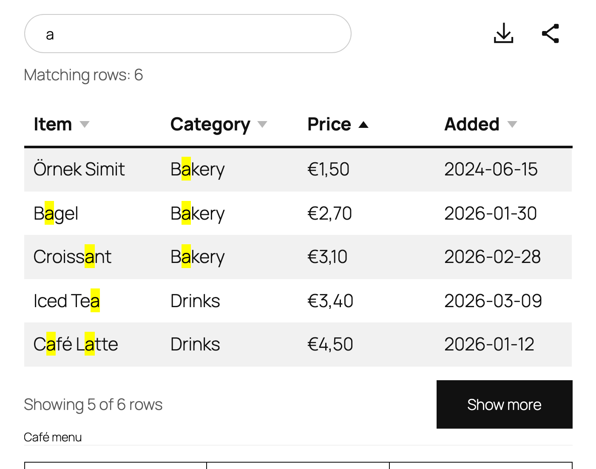
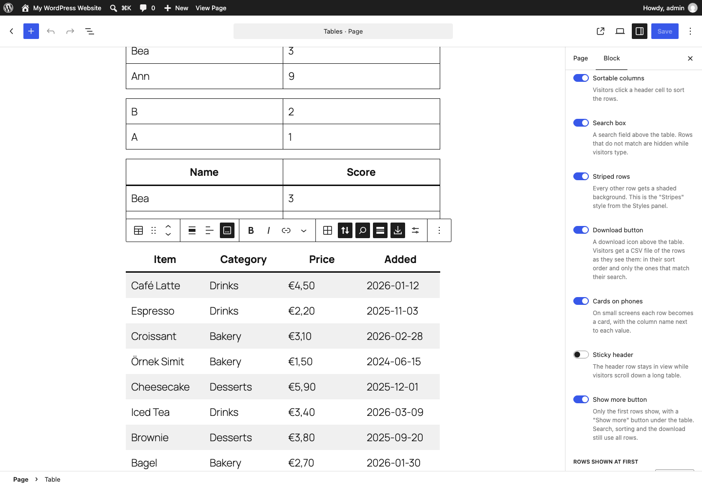
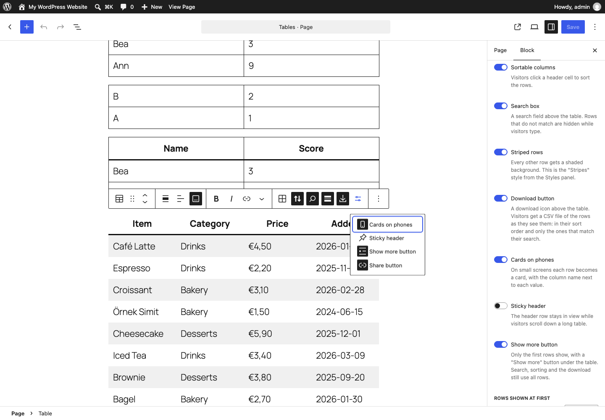
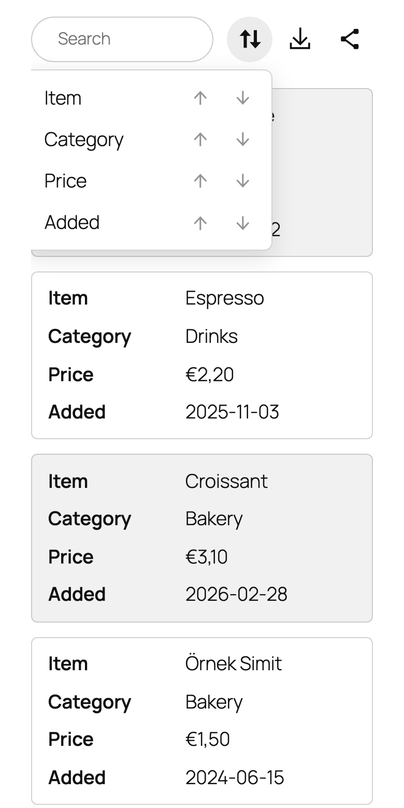

# Table Block Sort



Sorting, search, CSV download, phone cards, a sticky header and more for the WordPress **Table block** you already
use. No separate table editor, no new way of storing tables: each feature is a switch on the core Table block.

## What it adds

Select a table in the editor. Its toolbar gets four buttons next to "Edit table" (sort, search, stripes, download)
and a "More table tools" menu. The block sidebar gets a "Visitor tools" panel with all of them.

| Switch | What visitors get |
|---|---|
| Sortable columns | Each header cell becomes a button: low to high, then high to low. `aria-sort` for screen readers. |
| Search box | WordPress' own search field above the table. Rows that do not match are hidden while typing, matches are highlighted. |
| Striped rows | Core's "Stripes" style, with the stripe mixed from the theme's text color so it also works on dark themes. |
| Download button | A CSV of the rows as the visitor sees them: in their sort order and only the ones that match their search. |
| Cards on phones | Under 600px each row becomes a card with the column names; sorting moves to a small menu. |
| Sticky header | The header row stays in view on long tables. |
| Show more button | Only the first rows show (3 to 100), with "Show more" under the table. |
| Share button | The sort and search are kept in the page address; the icon shares or copies that link. |



## How columns are sorted

A column sorts by date when more than half of its cells are dates, by number when more than half are numbers,
otherwise as text in the site language's alphabetical order ("Item 2" before "Item 10").

- Prices and numbers in the usual shapes: `$50`, `$1,200.00`, `US$ 100`, `15 USD`, `AED 1,200`, `9,99 €`, `50,- €`,
  `-$20`, `($40)`, `12%`, `$1.2M`, `$800K`, `2,5 Mio.`, `12 kg`, `~$40`, ranges (`$50-$100` sorts by 50), Arabic digits.
- The decimal sign is worked out per column, so `€9,99` is 9.99 even on an English site.
- Dates: ISO with or without a time, `14.03.2026`, `3/14/2026`, `14 March 2026`, `Mar 3, 2026`, `March 2nd, 2026`,
  `Sat, 14 Feb 2026`, `December 2025`, times like `9:05 PM`, and month names in the site language.
- For `03/04/2026` the column decides the day and month order: a first number above 12 anywhere means day first.
- Cells that are not values ("Free") come after the values; empty cells and placeholders ("-", "N/A") always last.

The cases are in [`verify/sort-cases.json`](verify/sort-cases.json) and run on a test page in five languages.

## Screenshots

| Editor | More tools | Phone |
|---|---|---|
|  |  |  |

## Light by design

- One readable JavaScript file and one stylesheet, loaded only on pages with a table that uses these tools.
- No jQuery, no build step, no external requests, no tracking, nothing stored in the database.
- The settings live in the block itself. Deactivate the plugin and the tables stay normal tables.
- Without JavaScript the table shows as a normal table; the search field and icons stay hidden.

## Requirements

WordPress 6.3 or later, PHP 7.4 or later.

## Development

```bash
bin/build-zip.sh          # checks PHP and JS syntax, builds dist/table-block-sort.zip
```

[`verify/README.md`](verify/README.md) runs the plugin on a throwaway WordPress in WordPress Playground with demo
pages (`/tables/`, `/sort-tests/`) and the steps to check each feature.

## License

GPLv2 or later.
